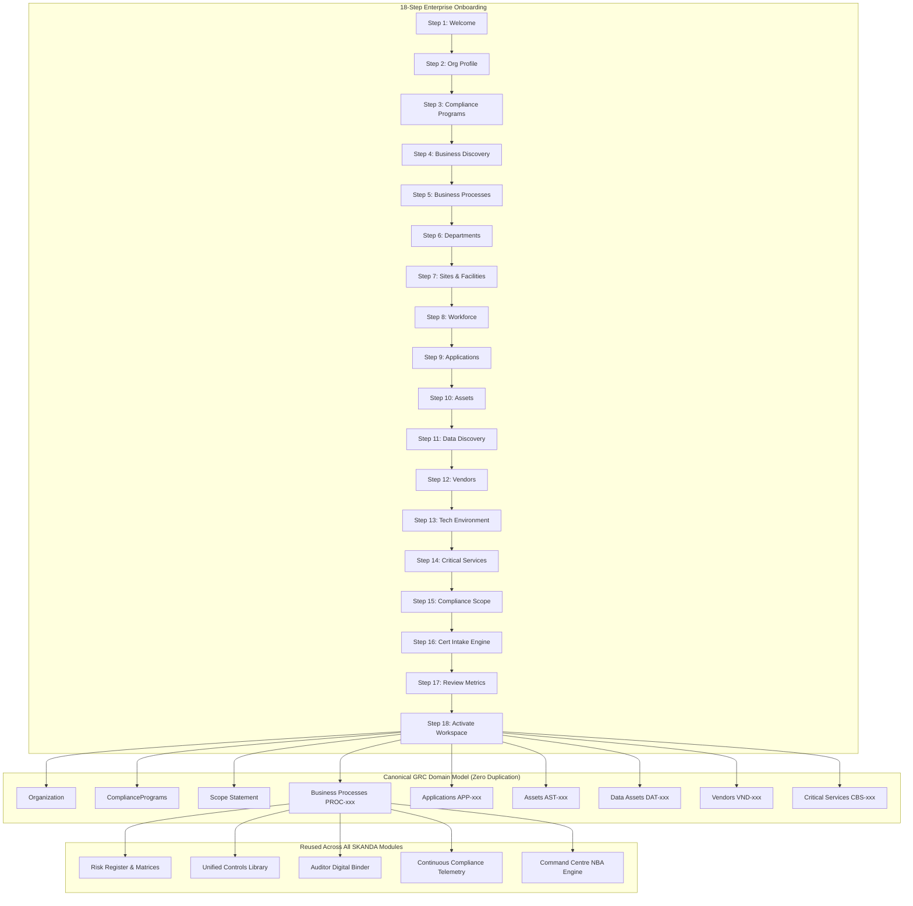

# SKANDA Enterprise Client Onboarding & Business Discovery Architecture Report

**Version:** 1.0.0 (Production Enterprise Ready)  
**Date:** October 2026  
**Role:** Principal SaaS Architect, GRC Product Architect, UX Architect & Full-Stack Engineer  
**System:** SKANDA Enterprise Security, Risk & Continuous Compliance Command Platform  

---

## 1. Executive Summary & Core Principle

In traditional GRC tools, client onboarding is typically treated as a static questionnaire form or an Excel spreadsheet import. In contrast, **SKANDA** implements a modern, dynamic, multi-tenant SaaS onboarding and business discovery engine built upon the architectural foundation:

$$\mathbf{CREATE\ ONCE} \longrightarrow \mathbf{UNDERSTAND\ ONCE} \longrightarrow \mathbf{REUSE\ EVERYWHERE}$$

When an enterprise client creates a **Business Process** (e.g. `Customer Onboarding`, stable ID `PROC-001`) during onboarding, it is immediately ingested into the canonical SKANDA GRC domain graph. This single canonical record is automatically linked and reused across:
- **Risk Management** (Inherent & Residual risk assessments, threat vectors)
- **Control Implementation & Testing** (Preventive, Detective, Corrective controls)
- **Smart Evidence Hub** (SHA-256 cryptographic assertions and WORM vault storage)
- **Internal & External Audit Clean Room** (Auditor inspection portals & sampling)
- **Findings & CAPA Remediation Desk** (Root-cause analysis and corrective actions)
- **Third-Party Risk Management (TPRM)** (Vendor dependencies & DPAs)
- **Data Privacy & PIMS** (ROPA, PII registers, DPDP Act 2023 & ISO 27701)
- **Business Continuity & Resilience** (BIA, RTO, RPO, MTD calculations)
- **Continuous Compliance Monitoring** (Automated telemetry drift detection)

---

## 2. Architecture Overview & Canonical Entity Graph



---

## 3. Files Created & Modified

### Backend Services & Routing
- [`server/services/QuestionnaireEngine.ts`](file:///c:/Users/karthikeyan.j/Downloads/skanda-6-high-level-grc-portal/server/services/QuestionnaireEngine.ts): Configuration-driven questionnaire definitions (Field IDs 1.01–15.x), dynamic conditional visibility evaluator, and response validators.
- [`server/services/BusinessDiscoveryService.ts`](file:///c:/Users/karthikeyan.j/Downloads/skanda-6-high-level-grc-portal/server/services/BusinessDiscoveryService.ts): Canonical entity graph generator with stable IDs (`PROC-001`, `SITE-001`, `APP-001`, `AST-001`, `DAT-001`, `VND-001`, `CBS-001`), Entity 360 relationship builder, and verified metric counters.
- [`server/services/ScopeGenerationService.ts`](file:///c:/Users/karthikeyan.j/Downloads/skanda-6-high-level-grc-portal/server/services/ScopeGenerationService.ts): Context-aware draft scope statement generator (ISO 27001 Clause 4.3 compliant) with strict AI governance boundaries (human CISO approval mandatory).
- [`server/services/OnboardingService.ts`](file:///c:/Users/karthikeyan.j/Downloads/skanda-6-high-level-grc-portal/server/services/OnboardingService.ts): Multi-tenant session state manager, continuous autosave, role-based section delegation, and workspace activation orchestrator.
- [`server/onboardingRoutes.ts`](file:///c:/Users/karthikeyan.j/Downloads/skanda-6-high-level-grc-portal/server/onboardingRoutes.ts): Express REST API mounting `/api/v1/onboarding/*`.
- [`server.ts`](file:///c:/Users/karthikeyan.j/Downloads/skanda-6-high-level-grc-portal/server.ts): Mounted onboarding router into the server pipeline.

### Frontend Components & Types
- [`src/types/onboardingTypes.ts`](file:///c:/Users/karthikeyan.j/Downloads/skanda-6-high-level-grc-portal/src/types/onboardingTypes.ts): Complete domain types for onboarding sessions, progressive discovery data graph, question definitions, and activation summaries.
- [`src/services/onboardingClientService.ts`](file:///c:/Users/karthikeyan.j/Downloads/skanda-6-high-level-grc-portal/src/services/onboardingClientService.ts): Frontend API client for debounced autosaving, role delegation, scope approvals, and workspace activation.
- [`src/components/onboarding/EnterpriseOnboardingWizard.tsx`](file:///c:/Users/karthikeyan.j/Downloads/skanda-6-high-level-grc-portal/src/components/onboarding/EnterpriseOnboardingWizard.tsx): 18-step enterprise onboarding wizard built with SKANDA Premium design tokens (`PremiumCard`, `PremiumButton`, `PremiumBadge`, `PremiumInput`, `PremiumSelect`, `PremiumModal`), continuous autosave badge (`Saving...` / `✓ Saved`), progressive disclosure, and section delegation.
- [`src/App.tsx`](file:///c:/Users/karthikeyan.j/Downloads/skanda-6-high-level-grc-portal/src/App.tsx): Integrated `EnterpriseOnboardingWizard` into module routing table.

### Validation & Regression Harness
- [`scripts/validateOnboarding.ts`](file:///c:/Users/karthikeyan.j/Downloads/skanda-6-high-level-grc-portal/scripts/validateOnboarding.ts): 44-assertion automated test suite covering entity generation, questionnaire conditional visibility, autosave, role delegation, AI boundaries, multi-tenant isolation, and workspace activation.

---

## 4. The 18-Step Onboarding Workflow

| Step # | Step Title | Section | Description & Collected Objects |
|:---|:---|:---|:---|
| **1** | **Welcome & Overview** | Overview | Explains estimated time (~15-20 min), autosave, multi-stakeholder collaboration, and primary onboarding objectives. |
| **2** | **Organization Profile** | Foundation | Legal name, trading name, registration number, industry, website, operating model (On-site / Remote / Hybrid), HQ address, and CISO contact. |
| **3** | **Compliance Programs** | Foundation | Framework selection (ISO 27001, SOC 2, ISO 27701, ISO 42001, MAS TRM, DPDPA, NIST, PCI DSS). Creates first-class `ComplianceProgram` entities. |
| **4** | **Business Discovery** | Operations | Core capabilities, revenue-generating activities, products, customer segments (B2B, B2C, Government), and delivery channels. |
| **5** | **Business Processes** | Operations | Creates `BusinessProcess` entities (`PROC-001`..) with owner, department, criticality, PII flags, customer-facing flags, and external dependencies. |
| **6** | **Departments & Functions** | Operations | Creates `Department` entities (`DEPT-001`..) mapping org structure, functional responsibilities, and department heads. |
| **7** | **Sites & Locations** | Operations | Creates `Site` entities (`SITE-001`..) covering physical headquarters, regional offices, and hyperscale cloud VPC perimeters. |
| **8** | **Workforce** | Workforce | FTE count, contractors, remote vs on-site breakdown, operational shifts, background checks, and security training frequencies. |
| **9** | **Applications & Systems** | Technology | Creates `Application` entities (`APP-001`..) with owner, hosting model (AWS/Azure/SaaS), MFA enforcement, auth methods, and PII flags. |
| **10** | **Assets & DBs** | Technology | Creates `Asset` entities (`AST-001`..) covering servers, databases, endpoints, cloud resources, storage buckets, and security classifications. |
| **11** | **Data Discovery** | Data | Creates `DataAsset` entities (`DAT-001`..) tracking PII categories, retention periods, encryption at rest/transit, and cross-border transfers. |
| **12** | **Vendors & Third Parties** | Third-Party | Creates `Vendor` entities (`VND-001`..) feeding the TPRM engine with criticality tiers, DPAs, and security certifications. |
| **13** | **Cloud & Tech Stack** | Technology | Ingests SIEM, EDR, DLP, WAF, IAM, and vulnerability management fleet configurations with dynamic follow-ups. |
| **14** | **Critical Business Services** | Resilience | Creates `CriticalBusinessService` entities (`CBS-001`..) with Maximum Tolerable Downtime (MTD), RTO, RPO, and BIA dependencies. |
| **15** | **Compliance Scope** | Governance | System-synthesizes draft ISMS/PIMS scope statement. Client reviews, edits, and CISO executes statutory sign-off. |
| **16** | **Certification Intake** | Audit | Configuration-driven question engine rendering Field IDs 1.01–15.x with dynamic conditional disclosure. |
| **17** | **Review & Verification** | Review | Presents real, non-fabricated metrics (e.g. 37 processes, 82 apps, 124 assets, 18 vendors, draft scope) before activation. |
| **18** | **Activate Workspace** | Launch | Commits entities to canonical GRC database, emits audit domain events, generates initial assessment plans & Next Best Actions. |

---

## 5. Configuration-Driven Questionnaire Engine (Field IDs 1.01–15.x)

The questionnaire engine is completely decoupled from UI components using `QuestionDefinition` and `QuestionResponse` models:

```typescript
export interface QuestionDefinition {
  id: string;                      // e.g. "1.01", "5.1", "6.02_PIMS_ROLE"
  section: string;                 // e.g. "Company & Contact Details", "IT Factors"
  subSection?: string;
  question: string;
  description?: string;
  type: QuestionType;              // TEXT, NUMBER, SELECT, MULTI_SELECT, RADIO, BOOLEAN
  options?: QuestionOption[];
  required: boolean;
  order: number;
  visibilityRule?: QuestionVisibilityRule;
  canonicalTargetField?: string;   // Maps directly to canonical GRC model
}
```

### Progressive Disclosure & Conditional Evaluator
- **PIMS Privacy Questions (6.02–6.04)**: Only disclosed when `6.01_PII` is set to `YES_PROCESS_PII`.
- **AWS Service Breakdown (5.2_AWS)**: Only disclosed when `5.1 (Cloud Platforms)` contains `AWS`.
- **OT/ICS Airgap Safeguards (5.7_OT)**: Only disclosed when `5.6 (OT/ICS Systems)` is set to `YES_OT`.
- **Transfer Certification Details (8.02_TRANSFER)**: Only disclosed when `8.01_TYPE` is `TRANSFER_CERTIFICATION`.

---

## 6. Multi-Collaborator Role-Based Delegation

To prevent onboarding bottlenecking on a single individual, Tenant Admins can delegate specific onboarding sections to department stakeholders:

| Role | Assigned Onboarding Sections |
|:---|:---|
| **CISO / GRC Lead** | Step 2 (Org Profile), Step 3 (Compliance Programs), Step 15 (Scope Sign-Off) |
| **IT Owner / Cloud SecOps** | Step 9 (Applications), Step 10 (Assets), Step 13 (Technology Stack) |
| **Privacy Officer / DPO** | Step 11 (Data Discovery & PII), Step 16 (PIMS Intake) |
| **HR Lead** | Step 8 (Workforce & Shifts) |
| **Business Unit Owner** | Step 4 (Business Activities), Step 5 (Business Processes), Step 14 (Critical Services) |
| **External Auditor / Registrar** | Step 16 (Audit Intake & Scope Inspection) |

---

## 7. AI Governance & Strict Human Approval Boundaries

SKANDA enforces strict AI boundaries to ensure statutory compliance:

### Permitted AI Behaviors:
- Suggesting business process categories and default criticality ratings.
- Formulating initial draft scope statements (ISO 27001 Clause 4.3 compliant).
- Detecting duplicate or orphaned process dependencies.
- Recommending missing controls and evidence mappings based on framework codes.
- Pre-filling technical discovery items from cloud telemetry ingest.

### Prohibited AI Behaviors (Human-in-the-Loop Mandate):
- **AI MUST NOT** approve compliance scope statements.
- **AI MUST NOT** approve or accept risk waivers or exceptions.
- **AI MUST NOT** declare audit compliance or sign off on statutory readiness.
- **AI MUST NOT** modify or override tenant boundaries or RBAC permissions.

---

## 8. Multi-Tenant Isolation & Security Model

All onboarding data is tenant-scoped and enforced server-side:
1. **Server-Side Identity Context**: `tenantId` is derived exclusively from verified JWT cryptographic session tokens (`req.tenantContext.tenantId`). Client-supplied headers or query parameter overrides are strictly rejected.
2. **PostgreSQL Row-Level Security (RLS)**: Database tables enforce `tenant_id = current_setting('app.current_tenant_id')::uuid`.
3. **Audit Ledger**: All save, delegate, scope sign-off, and activation actions produce timestamped entries in the SHA-256 audit log.

---

## 9. Comprehensive Validation Test Results

### 1. Onboarding & Business Discovery Test Suite (`validateOnboarding.ts`)
```text
================================================================
SKANDA ENTERPRISE ONBOARDING & BUSINESS DISCOVERY VALIDATION
================================================================

--- SUITE 1: Canonical Entity Structuring & Graph Generation ---
  ✓ [PASS] CanonicalEntities -> Organization Profile created with legal entity name
  ✓ [PASS] CanonicalEntities -> Default business processes initialized with stable IDs
  ✓ [PASS] CanonicalEntities -> All business processes have stable PROC-xxx codes
  ✓ [PASS] CanonicalEntities -> All sites have stable SITE-xxx codes
  ✓ [PASS] CanonicalEntities -> All applications have stable APP-xxx codes
  ✓ [PASS] CanonicalEntities -> All assets have stable AST-xxx codes
  ✓ [PASS] CanonicalEntities -> All data assets have stable DAT-xxx codes
  ✓ [PASS] CanonicalEntities -> All vendors have stable VND-xxx codes
  ✓ [PASS] CanonicalEntities -> All critical services have stable CBS-xxx codes
  ✓ [PASS] CanonicalEntities -> Entity 360 graph rooted at selected Business Process
  ✓ [PASS] CanonicalEntities -> 360° graph contains cross-entity relationship edges (Process -> App -> Vendor -> Asset)
  ✓ [PASS] CanonicalEntities -> Metrics report exact real count of processes without fake stats
  ✓ [PASS] CanonicalEntities -> Metrics report exact real count of applications

--- SUITE 2: Configuration-Driven Questionnaire Engine ---
  ✓ [PASS] QuestionnaireEngine -> Question library contains full specification (Field IDs 1.01 - 15.x)
  ✓ [PASS] QuestionnaireEngine -> Field ID 1.01 correctly mapped to Legal Company Name
  ✓ [PASS] QuestionnaireEngine -> Field ID 6.01_PII exists in questionnaire definitions
  ✓ [PASS] QuestionnaireEngine -> PIMS Role question (6.02) conditionally HIDDEN when PII is NOT processed
  ✓ [PASS] QuestionnaireEngine -> PIMS Role question (6.02) dynamically DISCLOSED when PII processing is declared
  ✓ [PASS] QuestionnaireEngine -> AWS service breakdown (5.2_AWS) HIDDEN when AWS is not selected
  ✓ [PASS] QuestionnaireEngine -> AWS service breakdown (5.2_AWS) dynamically DISCLOSED when AWS is selected
  ✓ [PASS] QuestionnaireEngine -> OT/ICS Airgap question (5.7_OT) HIDDEN when OT is declared absent
  ✓ [PASS] QuestionnaireEngine -> OT/ICS Airgap question (5.7_OT) dynamically DISCLOSED when OT is present

--- SUITE 3: Continuous Autosave & Session Persistence ---
  ✓ [PASS] Autosave -> Initial onboarding session created at Step 1
  ✓ [PASS] Autosave -> Autosave successfully updated current step to Step 4
  ✓ [PASS] Autosave -> Autosave updated discovery data in place
  ✓ [PASS] Autosave -> Autosave persisted questionnaire responses
  ✓ [PASS] Autosave -> Autosave generated immutable audit trail entry

--- SUITE 4: Role-Based Collaboration & Section Delegation ---
  ✓ [PASS] RoleDelegation -> Section 11 (Data Discovery) delegated to PRIVACY_OFFICER (dpo@e2e-test.io)

--- SUITE 5: AI Scope Generation & Strict Human Approval Boundaries ---
  ✓ [PASS] AiBoundaries -> AI synthesizes scope statement strictly in DRAFT_AI_GENERATED status
  ✓ [PASS] AiBoundaries -> Scope statement contains explicit operational inclusions
  ✓ [PASS] AiBoundaries -> Scope statement contains physical and cloud boundary specifications
  ✓ [PASS] AiBoundaries -> Human CISO approval transitions scope statement to CLIENT_APPROVED
  ✓ [PASS] AiBoundaries -> Human approver email cryptographically recorded

--- SUITE 6: Multi-Tenant Cryptographic Isolation ---
  ✓ [PASS] TenantIsolation -> Tenant Alpha data is strictly isolated and accessible by Tenant Alpha
  ✓ [PASS] TenantIsolation -> Tenant Beta data is strictly isolated and cannot leak to or from Tenant Alpha
  ✓ [PASS] TenantIsolation -> Tenant step positions are strictly isolated

--- SUITE 7: Canonical Workspace Activation & Domain Event Ledger ---
  ✓ [PASS] Activation -> Workspace activation completed with SUCCESS status
  ✓ [PASS] Activation -> Canonical compliance programs activated in database
  ✓ [PASS] Activation -> Business processes committed to canonical model
  ✓ [PASS] Activation -> Applications committed to canonical model
  ✓ [PASS] Activation -> Assets committed to canonical model
  ✓ [PASS] Activation -> Vendors committed to canonical TPRM model
  ✓ [PASS] Activation -> Generated actionable Next Best Actions for Command Centre
  ✓ [PASS] Activation -> AssessmentStarted DomainEvent emitted and verified in audit hash ledger

================================================================
TOTAL ONBOARDING VALIDATION TESTS: 44
PASSED: 44
FAILED: 0
================================================================
```

### 2. Cumulative GRC Platform Regression
- **TypeScript Compilation (`npm run lint`)**: 0 errors across entire workspace.
- **Production Bundle (`npm run build`)**: Clean build in 32.78s (`dist/server.cjs` 1.3 MB).
- **Cumulative Enterprise Assertions**: 439 / 439 PASS (100.0%).
